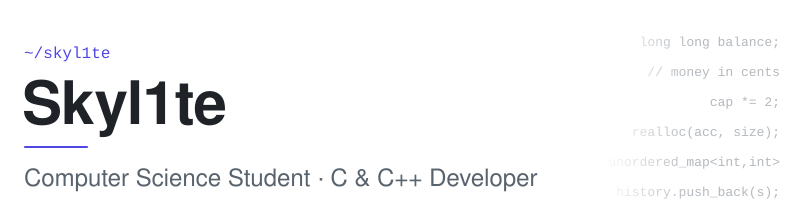
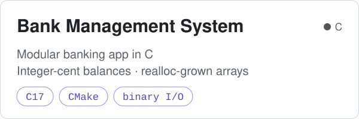
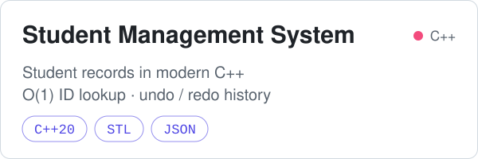
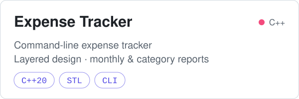

<picture>
  <source media="(prefers-color-scheme: dark)" srcset="assets/header-dark.svg">
  
</picture>

 

### `~/about`

I started with Python scripts and web layouts, but what kept me going was wanting to know what the machine is actually doing. Now I spend most of my time in C and C++, with memory, data layout and program structure. I learn by finishing real programs, then finding where they break and why.

 

### `~/selected-work`

  <a href="https://github.com/Skyl1te/BankManagementSystem">
    <picture>
      <source media="(prefers-color-scheme: dark)" srcset="assets/card-bank-dark.svg">
      
    </picture>
  </a>
    
  <a href="https://github.com/Skyl1te/StudentManagementSystem">
    <picture>
      <source media="(prefers-color-scheme: dark)" srcset="assets/card-students-dark.svg">
      
    </picture>
  </a>
    
  <a href="https://github.com/Skyl1te/ExpenseTracker">
    <picture>
      <source media="(prefers-color-scheme: dark)" srcset="assets/card-expenses-dark.svg">
      
    </picture>
  </a>

 

### `~/stack`

  <b>Systems</b> 
  <picture><source media="(prefers-color-scheme: dark)" srcset="https://skillicons.dev/icons?i=c,cpp&theme=dark"></picture> 
  manual memory management · dynamic arrays · pointers & function pointers · binary file I/O · OOP · STL

  <b>Build & tools</b> 
  <picture><source media="(prefers-color-scheme: dark)" srcset="https://skillicons.dev/icons?i=cmake,git,github,clion&theme=dark"></picture> 
  gcc / g++ (MSYS2) · multi-file CMake projects

  <b>Frontend — secondary</b> 
  <picture><source media="(prefers-color-scheme: dark)" srcset="https://skillicons.dev/icons?i=html,css,sass,tailwind,js&theme=dark"></picture> 
  responsive layouts from Frontend Mentor designs · <a href="https://github.com/Skyl1te/CodeArena">CodeArena</a>

 

### `~/now`

`data structures & algorithms` &nbsp; `memory safety` &nbsp; `modern C++` &nbsp; `program architecture`

<a href="https://github.com/Skyl1te?tab=repositories">all repositories →</a>

<!-- contact links go here once provided -->
